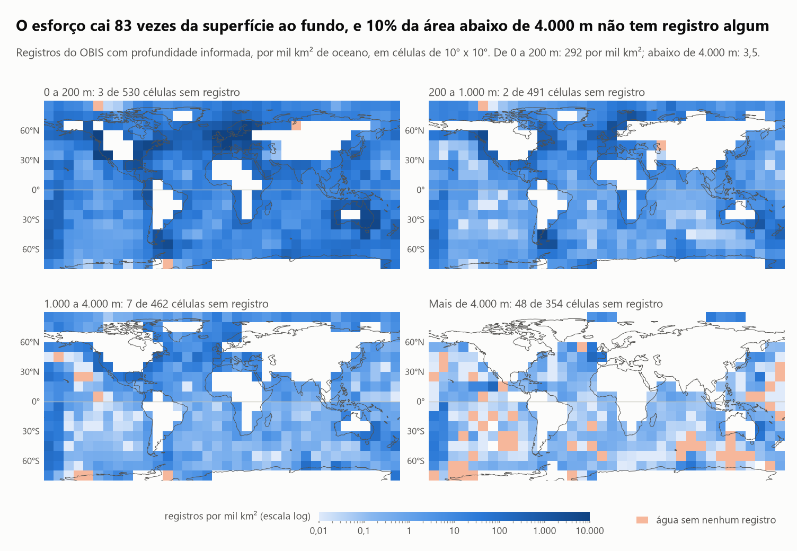
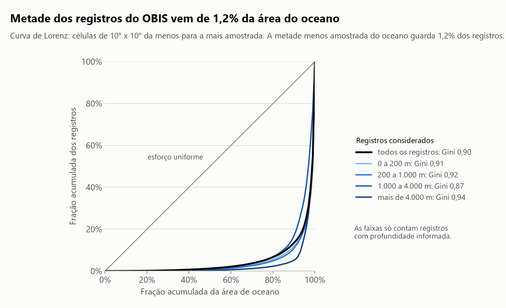
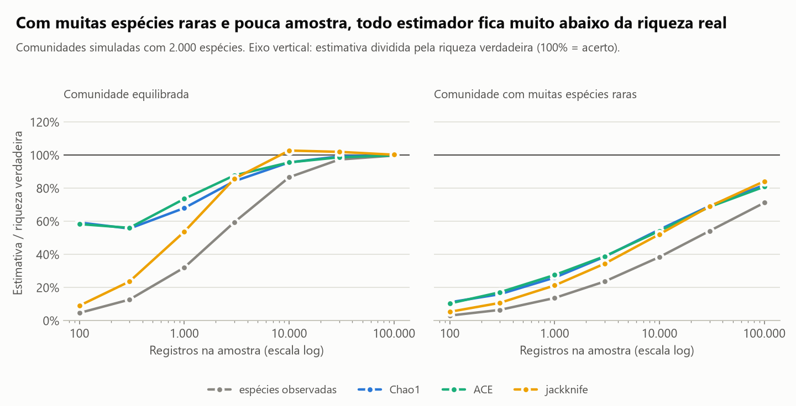
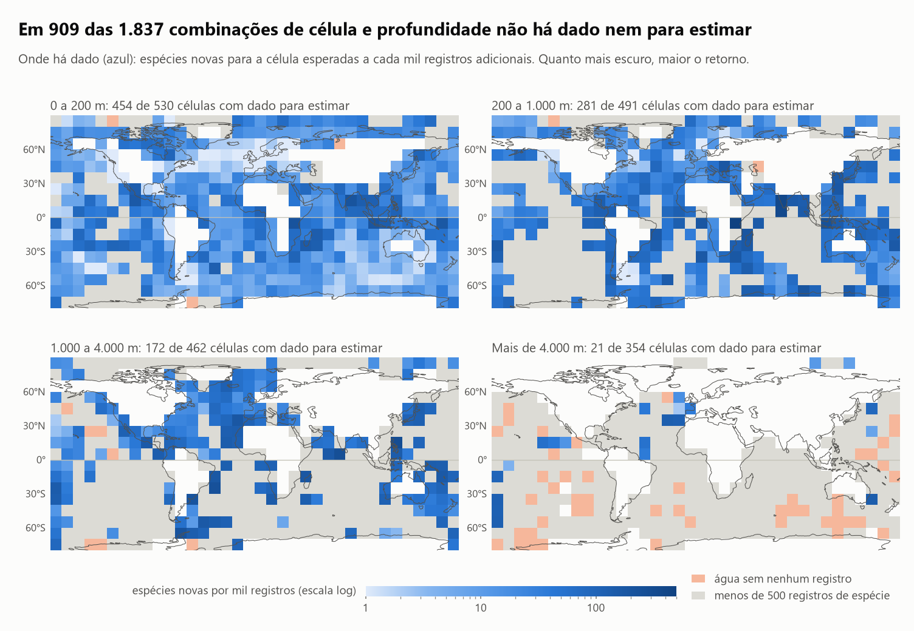
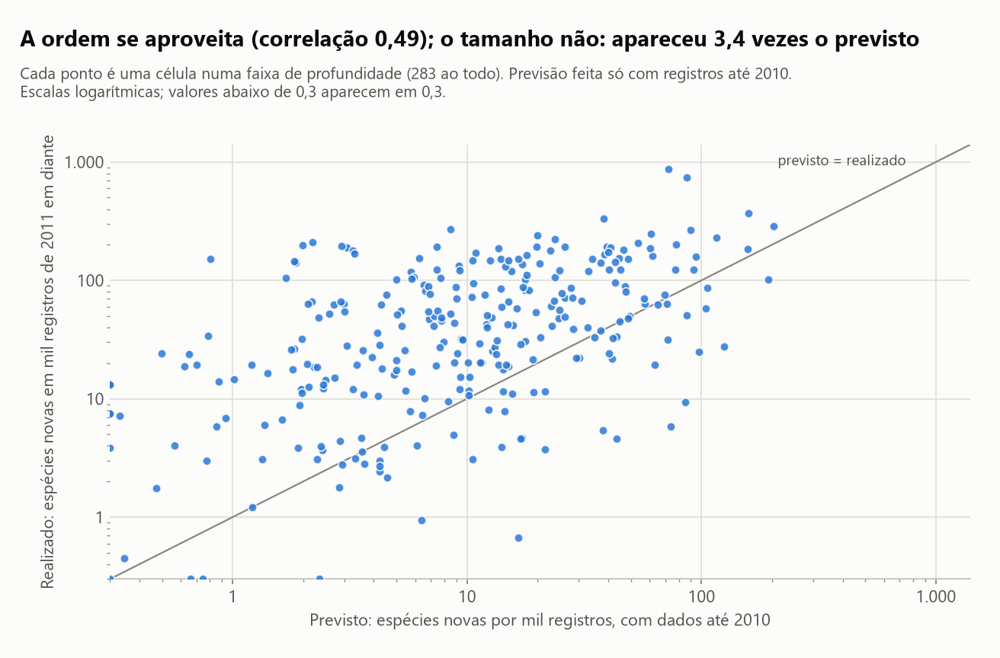
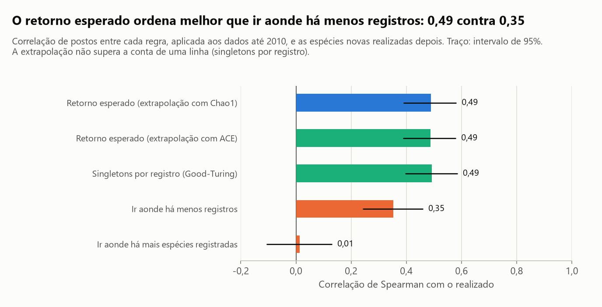

# Onde o oceano ainda não foi amostrado, e onde uma expedição renderia mais espécies ainda não registradas?

**Em 49% das 1.837 combinações de célula de 10° x 10° e faixa de profundidade, o OBIS não tem registros suficientes
nem para estimar quantas espécies faltam; abaixo de 4.000 m isso vale para 93% da área.** Onde há dado, ordenar as
células pelo retorno esperado (espécies novas para a célula a cada mil registros adicionais) teve correlação de
**0,49** (intervalo de 95%: 0,39 a 0,58) com o que de fato apareceu depois de 2010, contra 0,35 de "ir aonde há
menos registros" e 0,01 de "ir aonde há mais espécies registradas". Duas ressalvas pesam tanto quanto o resultado:
a conta de uma linha (espécies com um único registro divididas pelo total de registros) ordena igualmente bem, e a
previsão erra o tamanho: apareceram 3,4 vezes mais espécies novas do que o previsto.

"Espécie nova", neste estudo inteiro, é **nova para a célula no OBIS**, não nova para a ciência. O estudo aponta
onde olhar; não descobre nada.

Este estudo continua, em escala global, a ideia de
[`vida-marinha-costa-brasileira`](https://github.com/ghitflux/vida-marinha-costa-brasileira), que mostrou na costa
do Brasil que o mapa de riqueza registrada é em boa parte um mapa de esforço.

## Em 30 segundos

- **O esforço é extremamente concentrado.** Metade dos 259 milhões de registros do OBIS vem de 1,2% da área do
  oceano; a metade menos amostrada do oceano guarda 1,2% dos registros (Gini de 0,90).
- **Quanto mais fundo, menos dado.** De 0 a 200 m há 292 registros por mil km²; abaixo de 4.000 m, 3,5: uma queda de
  83 vezes. A fração da área sem os 500 registros de espécie de que os estimadores precisam sobe de 11% na
  superfície para 47%, 64% e 93% nas faixas seguintes.
- **O hemisfério norte tem 2,5 vezes a densidade do sul** na faixa de 0 a 200 m (441 contra 180 registros por mil
  km²), com 43% da área e 63% dos registros.
- **Onde dá para estimar, o inventário está longe de completo.** Nas 960 unidades avaliáveis a completude mediana
  (espécies registradas sobre o Chao1) é 72%, e o Chao1 é um limite inferior. Só 213 passam de 80%.
- **O ranking presta para ordenar, não para dimensionar.** Na validação no tempo (283 unidades), as 20 primeiras do
  ranking renderam em média 197 espécies novas por mil registros, contra 114 das 20 com menos registros e 70 da
  média geral. Só 6% dos valores realizados caíram dentro do intervalo de 95% da previsão.
- **54% dos registros do OBIS não informam profundidade** e ficam fora da análise por faixa; 38% dos que informam
  não chegam ao nível de espécie.

## As figuras

### 1. O mapa do esforço



Cada célula de 10° x 10° aparece quatro vezes, uma por faixa de profundidade. A área usada é a área de oceano em que
aquela camada de água existe (a parte da célula com fundo abaixo de 200, 1.000 ou 4.000 m, medida no relevo
ETOPO1), e a célula encolhe com a latitude. Em laranja, água sem nenhum registro: 3 de 530 células na superfície e
48 de 354 abaixo de 4.000 m, quase todas no Pacífico e no Oceano Austral.

| Faixa | Área (milhões de km²) | Registros | Registros por mil km² | Área sem nenhum registro | Área sem dado para estimar | Gini |
|---|---|---|---|---|---|---|
| 0 a 200 m | 362 | 105,7 milhões | 292 | 0,1% | 11% | 0,91 |
| 200 a 1.000 m | 335 | 10,8 milhões | 32 | 0,04% | 47% | 0,92 |
| 1.000 a 4.000 m | 319 | 2,5 milhões | 7,9 | 1,5% | 64% | 0,87 |
| Mais de 4.000 m | 191 | 0,67 milhão | 3,5 | 10% | 93% | 0,94 |

### 2. A desigualdade do esforço



A curva de Lorenz ordena as células da menos para a mais amostrada. Os 10% do oceano mais amostrados reúnem 87% dos
registros. A linha preta usa todos os registros, com e sem profundidade; as azuis, só os que informam profundidade.

### 3. Onde os estimadores falham



Antes de aplicar ao oceano, os estimadores foram testados em comunidades simuladas com 2.000 espécies. Numa
comunidade com muitas espécies raras e 300 registros, o Chao1 devolve 16% da riqueza verdadeira; com 100 mil
registros, 82%, e o intervalo de 95% dele não contém a verdade em nenhuma das repetições. A previsão de curto prazo
resiste melhor: a partir de mil registros, as espécies novas previstas para os próximos mil ficam entre 96% e 101%
das verdadeiras. Por isso a pergunta de decisão é "quantas espécies novas nos próximos mil registros", e não
"quantas espécies existem na célula". Na simulação os registros são sorteados ao acaso; no OBIS, não (figura 5).

### 4. O mapa de prioridades



O oceano fica dividido em três zonas. Em laranja, água sem registro (60 unidades). Em cinza, unidades com registro
mas com menos de 500 identificados até espécie (849): ali nenhum estimador tem o que dizer, porque extrapolar mil
registros a partir de menos de 500 passa do dobro da amostra. Em azul, as 960 avaliáveis, coloridas pelo retorno
esperado.

As dez primeiras do ranking:

| Posto | Célula | Faixa | Registros de espécie | Espécies | Completude (IC 95%) | Novas por mil registros (IC 95%) | Alerta |
|---|---|---|---|---|---|---|---|
| 1 | 10°S a 0°, 30°E a 40°E | 200 a 1.000 m | 653 | 518 | 20% (15 a 26) | 581 (523 a 638) | 69% de uma compilação de literatura; 3% da célula é oceano |
| 2 | 10°N a 20°N, 70°E a 80°E | 200 a 1.000 m | 3.222 | 1.575 | 16% (14 a 20) | 376 (359 a 393) | |
| 3 | 0° a 10°N, 70°E a 80°E | 200 a 1.000 m | 3.179 | 1.493 | 21% (17 a 25) | 350 (332 a 368) | |
| 4 | 10°N a 20°N, 120°E a 130°E | 1.000 a 4.000 m | 545 | 340 | 41% (33 a 50) | 288 (243 a 334) | |
| 5 | 0° a 10°N, 70°E a 80°E | 1.000 a 4.000 m | 638 | 323 | 35% (27 a 45) | 269 (225 a 314) | |
| 6 | 10°S a 0°, 110°E a 120°E | 200 a 1.000 m | 894 | 478 | 49% (41 a 57) | 243 (209 a 278) | 50% de um conjunto |
| 7 | 30°S a 20°S, 40°W a 30°W | 1.000 a 4.000 m | 615 | 324 | 43% (34 a 53) | 240 (197 a 283) | |
| 8 | 10°S a 0°, 30°E a 40°E | 0 a 200 m | 1.525 | 659 | 53% (47 a 59) | 218 (198 a 239) | 65% de um conjunto; 3% da célula é oceano |
| 9 | 70°S a 60°S, 70°W a 60°W | 1.000 a 4.000 m | 726 | 412 | 55% (47 a 63) | 216 (183 a 250) | |
| 10 | 40°S a 30°S, 60°W a 50°W | 1.000 a 4.000 m | 567 | 304 | 46% (36 a 56) | 214 (171 a 257) | |

O primeiro lugar é um artefato e está aqui de propósito. A célula é a costa do Quênia e da Tanzânia, e 69% dos
registros daquela faixa vêm de um único conjunto, uma compilação de espécies citadas em artigos, que entra com
praticamente um registro por espécie. Uma amostra cheia de espécies com um registro só é lida pelos estimadores como
"falta quase tudo", quando o que ela diz é como aquele conjunto foi montado. Das 20 primeiras, 7 têm metade ou mais
dos registros vinda de um conjunto só; o CSV traz o alerta e um segundo posto que as exclui. Sem os alertas, o topo
é o Índico tropical entre 200 e 4.000 m (ao largo do sudoeste da Índia e das Maldivas), o mar profundo junto às
Filipinas, o Atlântico Sul ocidental e o entorno da Península Antártica entre 1.000 e 4.000 m. No outro extremo, as cinco unidades mais amostradas (Califórnia,
Mar do Norte, Mediterrâneo ocidental, ilhas Britânicas) têm completude entre 76% e 86% e retorno esperado abaixo de
uma espécie nova por mil registros.

### 5. A validação no tempo: previsto com dados até 2010, realizado depois



Para cada unidade com pelo menos 500 registros de espécie até 2010 e mil depois (283 unidades), a previsão usa só o
que havia até 2010. O realizado é quantas das espécies que só apareceram depois estariam em mil registros sorteados
entre os posteriores, o que põe todas as unidades no mesmo esforço. A ordem se aproveita: correlação de postos de
0,49. O tamanho não: a mediana da razão entre realizado e previsto é 3,4 (metade das unidades entre 1,3 e 8,2), o
realizado ficou acima do intervalo de 95% em 78% das unidades e dentro dele em 6%. O intervalo por bootstrap mede o
acaso do sorteio, e o erro que domina é outro: as campanhas posteriores a 2010 não são um novo sorteio da mesma
comunidade. A explicação mais provável, que este estudo não testa, é que elas trazem outros métodos (DNA ambiental,
por exemplo), outros grupos taxonômicos e outros pontos da célula.

### 6. Os rankings comparados



A leitura está na seção "Comparação com a alternativa simples", abaixo.

## Como foi feito

1. **Grade.** O globo em células de 10° x 10°, de 80°S a 90°N, cruzadas com quatro faixas de profundidade: 0 a 200
   m, 200 a 1.000 m, 1.000 a 4.000 m e mais de 4.000 m. Uma "unidade" é uma célula numa faixa. A área de cada
   unidade vem do relevo ETOPO1 amostrado a cada 0,5°: área da célula na esfera vezes a fração dela em que o fundo
   fica abaixo do topo da faixa.
2. **Coleta só por agregados.** Para cada unidade, a lista de táxons com contagem de registros (`/checklist` do
   OBIS), o maior conjunto de dados (`/facet`) e, para a validação, as mesmas listas até 2010 e de 2011 em diante.
   Nenhum registro individual é baixado. "Espécie" é o `speciesid` do WoRMS (nome aceito; subespécies somam na
   espécie). O extrato versionado guarda só a distribuição de frequência: quantas espécies com 1 registro, com 2 e
   assim por diante.
3. **Esforço.** Registros por mil km² de oceano em cada unidade, curva de Lorenz e Gini ponderados por área, por
   hemisfério e por faixa.
4. **Completude.** Para unidades com pelo menos 500 registros de espécie: Chao1 com intervalo log-normal, ACE,
   jackknife de primeira ordem, cobertura da amostra (Good-Turing com a correção de Chao e Jost) e riqueza
   padronizada por cobertura. Tudo implementado em NumPy/SciPy em `src/oceano_lacunas/riqueza.py` e testado contra
   contas feitas à mão e comunidades simuladas de riqueza conhecida, incluindo o caso em que falham.
5. **A pergunta de decisão.** Espécies novas esperadas nos próximos mil registros, pela extrapolação da curva de
   acumulação (Shen, Chao e Lin, 2003; Chao et al., 2014), com intervalo por bootstrap de 200 réplicas tiradas de
   uma comunidade que inclui as espécies não vistas. O ranking é refeito com o ACE no lugar do Chao1 e com a conta
   simples de Good-Turing.
6. **Linhas de base.** "Ir aonde há menos registros" e "ir aonde há mais espécies registradas", avaliadas no mesmo
   conjunto de unidades.
7. **Validação no tempo.** Corte em 2010, descrito na figura 5. Espécies que também têm registro sem data ficam
   fora das "novas", para não contar como nova uma espécie que pode ser antiga.
8. **Vieses medidos.** Conjunto dominante, registros sem profundidade, identificação acima de espécie. Os números
   estão em "Onde este estudo falha".

## Comparação com a alternativa simples

Correlação de postos (Spearman) entre cada regra, aplicada só aos dados até 2010, e as espécies novas realizadas em
mil registros posteriores, nas 283 unidades da validação. A última coluna é o rendimento médio das 20 unidades que
cada regra escolheria; a média geral é 70 e a melhor escolha possível daria 292.

| Regra | Correlação com o realizado (IC 95%) | Diferença para o retorno esperado (IC 95%) | Realizado médio nas 20 primeiras |
|---|---|---|---|
| **Retorno esperado, extrapolação com Chao1** | **0,49** (0,39 a 0,58) | | 197 |
| Retorno esperado, extrapolação com ACE | 0,49 (0,39 a 0,58) | 0,00 (0,00 a 0,00) | 157 |
| Singletons por registro (Good-Turing, uma linha) | 0,49 (0,40 a 0,58) | 0,00 (−0,02 a 0,01) | 161 |
| Ir aonde há menos registros | 0,35 (0,24 a 0,46) | 0,14 (0,06 a 0,21) | 114 |
| Ir aonde há mais espécies registradas | 0,01 (−0,10 a 0,13) | 0,48 (0,31 a 0,63) | 64 |

Com todas as letras:

- **O retorno esperado supera "ir aonde há menos registros"**, e a diferença não cabe no acaso (0,14; intervalo de
  0,06 a 0,21). A vantagem aparece nas três faixas com unidades suficientes: 0,48 contra 0,34 de 0 a 200 m (197
  unidades), 0,57 contra 0,42 de 200 a 1.000 m (62) e 0,25 contra 0,05 de 1.000 a 4.000 m (24).
- **"Ir aonde é mais rico" não prevê nada** (0,01). A contagem de espécies registradas acompanha o esforço passado,
  não o que falta.
- **A extrapolação não supera a conta de uma linha.** Dividir o número de espécies com um único registro pelo total
  de registros ordena tão bem quanto a curva extrapolada (diferença de 0,00; intervalo de −0,02 a 0,01). Para
  ordenar células, a maquinaria de Chao1, ACE e bootstrap é dispensável. Ela serve para outra coisa, dar um tamanho
  ao retorno e à completude, e é justamente no tamanho que a validação reprova (3,4 vezes).
- **Trocar de estimador quase não muda o ranking atual:** correlação de 0,996 entre o ranking com Chao1 e com ACE,
  com 17 das 20 primeiras em comum (14 de 20 com Good-Turing). A mediana da troca de posto é 5 em 960; a maior, 234.
- **Os três rankings não concordam em lugar nenhum.** Nas 960 unidades avaliáveis, o retorno esperado tem correlação
  de 0,60 com "menos registros" e de −0,02 com "mais espécies"; as listas das 20 primeiras têm 1 e 0 unidades em
  comum, e nenhuma unidade está nas três.
- **A linha de base mais literal não entra na conta.** "Ir aonde ninguém foi" aponta para as 909 unidades sem
  registro ou com amostra insuficiente. Nelas não há o que validar: nenhuma das regras, simples ou não, foi testada
  ali.

## Onde este estudo falha

- **Registro não é amostra aleatória, e a validação mede o custo disso.** Todos os estimadores supõem sorteio ao
  acaso de indivíduos. Na simulação a previsão de curto prazo acerta dentro de 5%; no OBIS o realizado foi 3,4 vezes
  o previsto e só 6% caíram no intervalo. Os intervalos do CSV medem o acaso do sorteio e subestimam a incerteza
  real. Use os números de retorno como ordem, não como contagem.
- **Um conjunto de dados dominando a unidade.** Em 453 das 960 unidades avaliáveis (47%), um único conjunto
  responde por metade ou mais dos registros; a mediana da fração do maior conjunto é 48%. O primeiro lugar do
  ranking é um artefato desse tipo. O alerta está no CSV, mas o limiar de 50% é arbitrário e conjunto dominante não
  é sinônimo de artefato: muitas vezes é a única expedição que passou por ali.
- **54% dos registros do OBIS não informam profundidade** (139,7 de 259,2 milhões) e não entram em nenhuma unidade.
  O mapa por faixa subestima o esforço, sobretudo o costeiro e o de superfície. A desigualdade medida com todos os
  registros (Gini de 0,90) usa a célula inteira para contornar isso.
- **38% dos registros com profundidade não chegam a espécie** (11% param em gênero) e ficam fora dos estimadores;
  abaixo de 1.000 m são mais de 70%. Há 107 unidades que passariam do limite de 500 se os registros de gênero
  contassem. O mar profundo é mais conhecido do que este estudo consegue enxergar.
- **Registro não é indivíduo.** Mil registros de uma espécie podem ser mil indivíduos, uma série temporal no mesmo
  ponto ou a mesma coleta duplicada entre fontes. Os estimadores de abundância tratam cada registro como um
  indivíduo sorteado; uma versão por incidência (por evento de coleta) seria mais defensável e pede o registro
  individual, que este estudo não baixa.
- **A validação só cobre onde houve muito esforço depois de 2010** (283 unidades com mil registros posteriores, 197
  delas na superfície, nenhuma abaixo de 4.000 m). Ela diz pouco sobre as unidades pobres em dado, que são as que
  mais interessam. E usa um único ano de corte.
- **O limite de 500 registros de espécie é uma escolha.** Vem da regra de não extrapolar além do dobro da amostra;
  outro limite muda quantas unidades são avaliáveis (hoje 960 de 1.837).
- **Célula de 10° é grosseira.** Mistura plataforma, talude e planície abissal, e províncias biogeográficas
  diferentes. Uma célula "bem amostrada" pode ter todo o esforço num canto.
- **Relevo amostrado a 0,5°, sem máscara de terra.** Depressões continentais abaixo do nível do mar entram como
  "água": é o caso da célula do mar Cáspio e de uma no oeste da Sibéria que aparecem em laranja no mapa. Em
  células quase todas de terra (a do primeiro lugar tem 3% de oceano) a área é imprecisa. Há 118.752 registros em
  unidades onde a amostra do relevo não vê água naquela profundidade.
- **Taxonomia.** O nome aceito do WoRMS resolve sinônimos conhecidos, mas não erros de identificação. Uma espécie
  mal identificada conta como "nova para a célula".
- **Coordenadas e datas.** Registros com coordenada arredondada ou em terra não foram filtrados além do que o OBIS
  já descarta; 4% dos registros não têm data e ficaram fora da validação.
- **Foto de um dia.** A coleta levou 2 h 47 min em 12/11/2026 e o OBIS cresce continuamente.

## O que faltaria para isto virar contribuição científica

- **Revisão por especialistas dos grupos e das regiões.** Quem conhece o mesopelágico do Índico ou o bentos
  antártico sabe se a lista de prioridades reflete lacuna de conhecimento ou lacuna de digitalização: muita coleta
  de mar profundo está em museu e em artigo, fora do OBIS.
- **Análise por grupo taxonômico.** Juntar foraminíferos, peixes e bactérias numa mesma curva de acumulação não tem
  sentido biológico. Um artigo faria a conta por grupo (ou por filo), com o esforço específico de cada um.
- **Estimadores por incidência**, com o evento de coleta como unidade amostral, a partir dos registros individuais,
  e tratamento de duplicatas entre conjuntos de dados.
- **Unidades biogeográficas no lugar da grade**, por exemplo províncias pelágicas e bentônicas, e batimetria de
  resolução plena para a área por profundidade.
- **Validação mais dura:** vários anos de corte, validação por conjunto de dados deixado de fora, e comparação com
  o que as expedições recentes de fato descreveram.
- **Comparação com a literatura.** O padrão geral (mar profundo e hemisfério sul pouco explorados) já foi descrito
  com dados do OBIS por Webb, Vanden Berghe e O'Dor (2010), e as lacunas por latitude por Menegotto e Rangel
  (2018). Um artigo teria de mostrar o que a validação no tempo acrescenta a esses trabalhos.
- **Separar "nova para a célula" de "nova para a ciência".** São perguntas diferentes; a segunda exige taxonomia
  de bancada, não dado de ocorrência.

## Para quem isto pode ser útil

- **Planejamento de expedições e de campanhas de amostragem:** a lista de unidades sem inventário mostra onde não
  há dado digital nenhum; o ranking mostra, entre as que têm dado, onde mil registros adicionais devem render mais
  espécies novas para a célula. Como ordem, não como contagem.
- **Nós e gestores de dados do OBIS e do GBIF:** as unidades com alerta de conjunto dominante e as com alta fração
  de registros sem profundidade ou acima de espécie indicam onde mobilizar dado já coletado (coleções, literatura)
  rende mais que coletar de novo.
- **Quem avalia lacunas para conservação** (planejamento espacial marinho, áreas além da jurisdição nacional): a
  tabela de completude evita ler ausência de registro como ausência de espécie.

Dois arquivos prontos para reuso, gerados por `scripts/rodar_analise.py`:

**[`reports/celulas_prioritarias.csv`](reports/celulas_prioritarias.csv)**: uma linha por unidade avaliável (960),
na ordem do retorno esperado.

| Coluna | O que é |
|---|---|
| `posto` | posto pelo retorno esperado (1 = maior) |
| `celula`, `rotulo`, `lat_sul`, `lon_oeste` | identificador pelo canto sudoeste (`N40W030`), rótulo legível e canto sudoeste em graus |
| `faixa` | `0-200`, `200-1000`, `1000-4000` ou `4000+` (metros) |
| `registros`, `registros_especie`, `especies` | registros na unidade, registros identificados até espécie e espécies registradas |
| `chao1`, `chao1_inf`, `chao1_sup`, `ace` | riqueza estimada (limite inferior) com intervalo de 95%, e o ACE |
| `completude`, `completude_inf`, `completude_sup` | espécies registradas sobre o Chao1, com intervalo de 95% |
| `cobertura` | cobertura da amostra (chance de o próximo registro ser de espécie já vista) |
| `novas_por_mil`, `novas_por_mil_inf`, `novas_por_mil_sup` | espécies novas para a célula esperadas em mil registros adicionais, com intervalo de 95% por bootstrap |
| `novas_por_mil_ace`, `posto_ace` | o mesmo com o ACE, e o posto correspondente |
| `posto_menos_registros`, `posto_mais_especies` | postos pelas duas linhas de base |
| `registros_para_cobertura_95` | registros adicionais estimados para chegar a 95% de cobertura |
| `fracao_acima_de_especie` | fração dos registros da unidade que não chega a espécie |
| `fracao_oceano` | fração da célula que é oceano |
| `fracao_maior_conjunto`, `maior_conjunto_titulo` | fração dos registros que vem do maior conjunto de dados, e o título dele |
| `alerta_conjunto_dominante`, `posto_sem_alerta` | verdadeiro se o maior conjunto tem 50% ou mais; posto entre as unidades sem alerta |

**[`reports/lacunas_sem_inventario.csv`](reports/lacunas_sem_inventario.csv)**: as 909 unidades com água e sem
inventário (`zona` = `sem registro` ou `amostra insuficiente`), com `area_faixa_km2`, `registros`,
`registros_especie` e `especies`.

Os intervalos de `novas_por_mil` e de `completude` medem só o acaso da amostragem. Leia a seção "Onde este estudo
falha" antes de usar os valores.

## Dados, licenças e referências

- **OBIS** (2026). *Ocean Biodiversity Information System*. Intergovernmental Oceanographic Commission of UNESCO.
  <https://obis.org>. Consulta em 12/11/2026 pela API v3 (`/checklist`, `/facet`, `/statistics`), com 259.198.986
  registros, 168.316 espécies e 7.305 conjuntos de dados. O OBIS reúne conjuntos com licenças diferentes (CC0,
  CC BY, CC BY-NC), cada um com os seus autores. Este repositório versiona apenas contagens agregadas (por célula,
  por unidade e distribuições de frequência) e o título do maior conjunto de cada unidade; nenhum registro
  individual é redistribuído.
- **ETOPO1**: Amante, C. e Eakins, B. W. (2009). *ETOPO1 1 Arc-Minute Global Relief Model*. NOAA Technical
  Memorandum NESDIS NGDC-24. Amostrado a cada 0,5° pelo ERDDAP da NOAA CoastWatch (conjunto `etopo180`).
- **Natural Earth**, linha de costa 1:110m, domínio público (<https://www.naturalearthdata.com>), só para desenhar
  os mapas.

Referências do método, conferidas uma a uma (autores, ano, título e periódico pelo DOI no Crossref; a de 1984, que
não tem DOI, por busca bibliográfica):

- Chao, A. (1984). Nonparametric estimation of the number of classes in a population. *Scandinavian Journal of
  Statistics*, 11, 265-270.
- Chao, A. (1987). Estimating the population size for capture-recapture data with unequal catchability.
  *Biometrics*, 43, 783-791. doi:10.2307/2531532
- Chao, A. e Lee, S.-M. (1992). Estimating the number of classes via sample coverage. *Journal of the American
  Statistical Association*, 87, 210-217. doi:10.1080/01621459.1992.10475194
- Burnham, K. P. e Overton, W. S. (1978). Estimation of the size of a closed population when capture probabilities
  vary among animals. *Biometrika*, 65, 625-633. doi:10.1093/biomet/65.3.625
- Good, I. J. (1953). The population frequencies of species and the estimation of population parameters.
  *Biometrika*, 40, 237-264. doi:10.1093/biomet/40.3-4.237
- Hurlbert, S. H. (1971). The nonconcept of species diversity: a critique and alternative parameters. *Ecology*,
  52, 577-586. doi:10.2307/1934145
- Shen, T.-J., Chao, A. e Lin, C.-F. (2003). Predicting the number of new species in further taxonomic sampling.
  *Ecology*, 84, 798-804. doi:10.1890/0012-9658(2003)084[0798:PTNONS]2.0.CO;2
- Chao, A. e Jost, L. (2012). Coverage-based rarefaction and extrapolation: standardizing samples by completeness
  rather than size. *Ecology*, 93, 2533-2547. doi:10.1890/11-1952.1
- Chao, A. et al. (2014). Rarefaction and extrapolation with Hill numbers: a framework for sampling and estimation
  in species diversity studies. *Ecological Monographs*, 84, 45-67. doi:10.1890/13-0133.1
- Webb, T. J., Vanden Berghe, E. e O'Dor, R. (2010). Biodiversity's big wet secret: the global distribution of
  marine biological records reveals chronic under-exploration of the deep pelagic ocean. *PLoS ONE*, 5, e10223.
  doi:10.1371/journal.pone.0010223
- Menegotto, A. e Rangel, T. F. (2018). Mapping knowledge gaps in marine diversity reveals a latitudinal gradient
  of missing species richness. *Nature Communications*, 9. doi:10.1038/s41467-018-07217-7

## Como rodar

Pré-requisito: [`uv`](https://docs.astral.sh/uv/getting-started/installation/).

```bash
uv sync
uv run python scripts/rodar_analise.py   # regera reports/ a partir do extrato em data/ (cerca de 35 s, sem rede)
uv run pytest -q -p no:cacheprovider     # 48 testes, não dependem dos dados nem da rede
uv run python scripts/baixar_dados.py    # opcional: recoleta no OBIS (cerca de 2 h 40 min, uma requisição por vez)
```

O extrato agregado de que a análise precisa está versionado em `data/` (4,3 MB), com o hash conferido na carga. O
bruto da coleta fica em `data/brutos/`, fora do git, e a coleta é retomável. O notebook
[`analise.ipynb`](analise.ipynb) conta a história com as tabelas.

```text
├── analise.ipynb
├── data/                     # celulas.csv, unidades.csv, frequencias.csv, coleta.json, linha de costa
├── src/oceano_lacunas/
│   ├── dados.py              # grade, coleta nas APIs, agregação e carga
│   ├── riqueza.py            # Chao1, ACE, jackknife, cobertura, rarefação, extrapolação, bootstrap
│   ├── esforco.py            # curva de Lorenz e Gini ponderados por área
│   ├── analise.py            # cada tabela do estudo, a validação no tempo e a simulação
│   └── graficos.py, estilo.py, site.py
├── scripts/                  # baixar_dados.py, rodar_analise.py
├── tests/                    # 48 testes (pytest)
└── reports/                  # resultados.json, figuras e os dois CSVs para reuso
```

## Como este estudo foi feito

Este estudo foi construído com assistência de IA (Claude Code, da Anthropic), usada como par de programação.
Declaro a divisão do trabalho porque ela importa para quem avalia:

- **Meu:** a escolha da frente (ciência de dados marinhos é o que mais quero estudar), o critério dos estudos
  (escopo global, espécies e lugares raros, utilidade para preservação), a leitura crítica dos resultados e a
  decisão do que publicar e do que declarar como limitação. Não sou biólogo: sou profissional de dados estudando
  o mar com dado público.
- **Com o assistente:** a formulação da pergunta, a escolha das bases e do método, a implementação do código, dos
  testes e dos gráficos, e a redação, que revisei.
- **Como conferir:** todo número deste README sai de `reports/resultados.json`, gerado por
  `scripts/rodar_analise.py`. Os testes em `tests/` conferem as funções de método contra casos de resposta
  conhecida.

A responsabilidade pelo que está escrito aqui é minha. Se você é da área e encontrou um erro, abra uma issue: é
o tipo de correção que eu quero receber.

## Summary (English)

Where has the ocean not been sampled, and where would an expedition add the most species not yet on record? Using
aggregated OBIS counts (259 million records, retrieved 2026-11-12) on a global 10° x 10° grid crossed with four
depth bands, this study maps sampling effort per ocean area and estimates inventory completeness with hand-written
Chao1, ACE, jackknife and sample-coverage estimators. Effort is extremely uneven (half of all records come from
1.2% of the ocean's area; density drops 83-fold from the top 200 m to below 4,000 m), and in 49% of all cell-by-depth
units, 93% of the area below 4,000 m, there are too few species-level records to estimate anything. Where data
exist, ranking units by expected new species per thousand additional records (curve extrapolation with bootstrap
intervals) was tested with a temporal split: predictions from records up to 2010 correlated 0.49 (95% CI 0.39 to
0.58) with what was actually recorded afterwards, better than "go where records are fewest" (0.35) and "go where
recorded richness is highest" (0.01). Two caveats are stated plainly: a one-line rule (singletons per record) ranks
just as well, and the forecast gets the size wrong, with 3.4 times more new species turning up than predicted,
because later campaigns are not a random redraw of the same community. "New" means new to the cell in OBIS, not new
to science. Code and notebook are in Portuguese.
